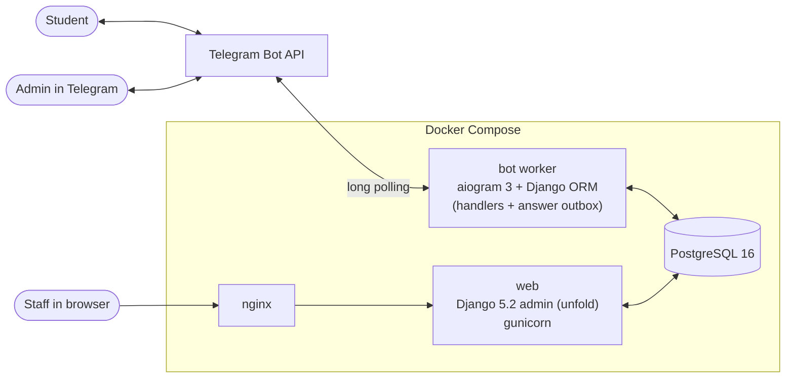
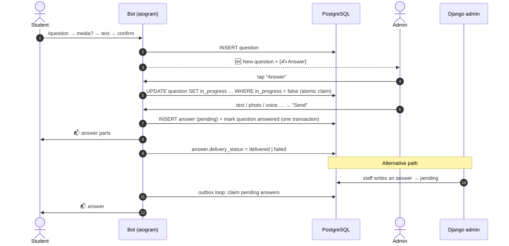

# Edu Help Bot

**A Telegram Q&A support desk for students.** Students send questions (text, photo or document) to a Telegram bot; admins answer them right inside Telegram or from a Django admin panel, and every answer is delivered back to the student with retries and delivery tracking.

[](https://github.com/samandar-hamrayev/edu-help-bot/actions/workflows/ci.yml)


[](LICENSE)

> The bot's user-facing texts are in Uzbek; code, admin panel and docs are in English.

<!-- Screenshot: student asking a question in Telegram (docs/screenshots/bot-question.png) -->
<!-- Screenshot: admin answering from Telegram (docs/screenshots/bot-answer.png) -->
<!-- Screenshot: Django admin (unfold) question list with delivery status (docs/screenshots/admin.png) -->

## Features

**For students**
- `/question` — guided flow: optionally attach a photo or document, write the question, preview and confirm.
- `/my_questions` — paginated history with status (⏳ waiting / ✅ answered); open any question to see its answers again.
- Optional mandatory channel/group membership before using the bot (configurable, admins are exempt).

**For admins in Telegram**
- Instant notification for every new question with a **✍️ Answer** button.
- Multi-part answers: text, photo, video, voice and documents, sent together on confirm.
- **Claim lock** — when one admin starts answering, others see "another admin is working on it" (stale locks expire after 30 min).
- `/pending_questions` (paginated) and `/stats` (users, questions, response time, failed deliveries).

**For staff in the web admin** (Django + [unfold](https://github.com/unfoldadmin/django-unfold))
- Browse/search questions and users, write an answer to any question from the browser.
- See each answer's delivery status (`pending → sending → delivered / failed`) and error; bulk *retry delivery* and *release lock* actions.

**Operational**
- Answers are stored first and delivered by an outbox loop: users who blocked the bot are marked `failed`, network/flood errors are retried.
- Docker Compose stack (PostgreSQL, gunicorn, bot worker, nginx) with healthchecks on every service.
- 90+ tests, ruff, pre-commit, GitHub Actions CI, Dependabot.

## Architecture



- **One codebase, two processes.** The bot imports Django (`django.setup()`) and uses the same models as the admin; there is no internal HTTP API between them.
- **Only the bot talks to Telegram.** Answers written in the web admin are saved with `delivery_status=pending`; the bot's outbox loop picks them up within `OUTBOX_POLL_INTERVAL` seconds. The web process doesn't need the bot token.

### Question → answer → notification



## Design decisions

| Decision | Why |
| --- | --- |
| **Save the answer, then deliver (outbox pattern)** | Telegram can fail (user blocked the bot, network, flood limits). Persisting first means no answer is ever lost; the delivery result is recorded and transient failures are retried up to 5 times. |
| **Bot process is the only Telegram client** | The web admin just writes rows. No bot token or async code in gunicorn workers, and both answer paths share one delivery implementation. |
| **Atomic claim with a conditional `UPDATE`** | The old "read `in_progress`, then save" let two admins claim the same question. `UPDATE … WHERE in_progress = false` is race-free; claims expire so a crashed session doesn't lock a question forever. |
| **Django async ORM (`aget`, `aupdate`, `async for`)** in handlers | aiogram is async; calling the sync ORM from it raises `SynchronousOnlyOperation`. Multi-statement writes that need `transaction.atomic` stay sync and are wrapped once with `sync_to_async`. |
| **Router-level `IsAdmin` filter** | Callback data is client-controlled. Guarding whole admin routers (not individual handlers) means a forged `answer_q_42` callback from a student can't reach admin code. |
| **`DbConnectionMiddleware`** | Django closes stale DB connections per HTTP request; a long-running bot has no requests, so a Postgres restart would leave it with a dead connection. |
| **Membership check fails closed, caches successes** | If Telegram can't confirm membership (e.g. bot isn't a channel admin) the user is asked to join rather than silently let through; positive results are cached for 5 minutes to avoid N API calls per message. |
| **HTML escaping everywhere + `parse_mode=None` for stored answers** | The bot's default parse mode is HTML; a student typing `<b>` used to break messages. |
| **`TELEGRAM_ADMINS`, not `ADMINS`** | `ADMINS` is a built-in Django setting (name/email pairs for error mails); putting Telegram ids there crashed Django's error logging on any 500. |
| **Secure-by-default settings** | `DEBUG` off unless enabled; `SECRET_KEY` required in production; hosts/CSRF origins from env; secrets only in `.env` (git-ignored). |

## Tech stack

| Layer | Technology |
| --- | --- |
| Bot | [aiogram 3](https://docs.aiogram.dev/) (long polling, FSM, routers, middlewares) |
| Admin / ORM | Django 5.2 LTS, django-unfold |
| Database | PostgreSQL 16 (psycopg 3) |
| Serving | gunicorn behind nginx |
| Packaging | Docker (python:3.12-slim, non-root), Docker Compose |
| Quality | pytest, pytest-django, pytest-asyncio, coverage, ruff, pre-commit, GitHub Actions, Dependabot |

## Quick start

### 1. Create a bot with BotFather

1. Open [@BotFather](https://t.me/BotFather) → `/newbot` → choose a name and username.
2. Copy the token into `BOT_TOKEN` in `.env` (never commit it).
3. Get your numeric Telegram id (e.g. from [@userinfobot](https://t.me/userinfobot)) and put it in `TELEGRAM_ADMINS`.
4. *(Optional)* For mandatory membership, add the bot as an **admin** of each channel/group and set `REQUIRED_CHATS_JSON`, e.g. `[[-1001234567890, "@my_channel"]]`.

### 2. Run with Docker (recommended)

```bash
git clone https://github.com/samandar-hamrayev/edu-help-bot.git
cd edu-help-bot
cp .env.example .env        # set SECRET_KEY, POSTGRES_PASSWORD, BOT_TOKEN, TELEGRAM_ADMINS
docker compose up -d --build
docker compose exec web python manage.py createsuperuser
```

Admin panel: <http://localhost:18580/admin/> (port from `NGINX_PORT`). Health check: `/healthz/`.

The `bot` service needs a valid `BOT_TOKEN`; without one it logs `BOT_TOKEN is not set` and keeps restarting while the web admin keeps working.

For production put TLS in front of nginx (or extend `nginx/conf.d`), set `ALLOWED_HOSTS`, `CSRF_TRUSTED_ORIGINS=https://your-domain` and `SECURE_COOKIES=True`.

### 3. Run locally (without Docker)

```bash
python3.12 -m venv .venv && source .venv/bin/activate
make install                 # requirements-dev.txt + pre-commit hooks
cp .env.example .env         # set POSTGRES_HOST=localhost, DEBUG=True, ...
make migrate
make run-web                 # http://127.0.0.1:8000/admin/
make run-bot                 # in a second terminal
```

## Configuration

All settings are environment variables (loaded from `.env` if present). See [`.env.example`](.env.example).

| Variable | Default | Description |
| --- | --- | --- |
| `SECRET_KEY` | — (**required** unless `DEBUG=True`) | Django secret key |
| `DEBUG` | `False` | Django debug mode |
| `ALLOWED_HOSTS` | empty (`localhost,127.0.0.1` in debug) | Comma-separated host names |
| `CSRF_TRUSTED_ORIGINS` | empty | Comma-separated origins, e.g. `https://admin.example.com` |
| `SECURE_COOKIES` | `not DEBUG` | Secure session/CSRF cookies (set `False` for plain-HTTP local testing) |
| `POSTGRES_DB` / `POSTGRES_USER` / `POSTGRES_PASSWORD` | `helpbot` / `helpbot` / empty | Database credentials |
| `POSTGRES_HOST` / `POSTGRES_PORT` | `localhost` / `5432` | Database address (`db` inside Compose) |
| `BOT_TOKEN` | — | Token from @BotFather (bot worker only) |
| `TELEGRAM_ADMINS` | empty | Comma-separated Telegram user ids that are always admins (legacy `ADMINS` also accepted) |
| `REQUIRED_CHATS_JSON` | `[]` | Chats users must join: `[[chat_id, "@username"], ...]` |
| `SUPPORT_CONTACT` | empty | Contact shown in `/help` |
| `OUTBOX_POLL_INTERVAL` | `5` | Seconds between delivery checks for admin-panel answers |
| `TIME_ZONE` | `Asia/Tashkent` | Django time zone |
| `LOG_LEVEL` | `INFO` | Root log level |
| `NGINX_PORT` | `18580` | Host port published by Compose |
| `GUNICORN_WORKERS` / `GUNICORN_THREADS` | `3` / `2` | gunicorn tuning |

Admins can also be granted in the web admin by ticking **is admin** on a Telegram user.

## Testing

Tests run against PostgreSQL (same as production). The Telegram API is **never** called: a `FakeBot` overrides `Bot.__call__` — the single entry point of every aiogram API method — and records requests, so updates go through the real dispatcher, routers, filters and middlewares.

```bash
# throwaway database
docker run -d --name helpbot-test-db -p 5433:5432 \
  -e POSTGRES_USER=helpbot -e POSTGRES_PASSWORD=helpbot -e POSTGRES_DB=helpbot postgres:16-alpine

export POSTGRES_HOST=localhost POSTGRES_PORT=5433 POSTGRES_USER=helpbot POSTGRES_PASSWORD=helpbot POSTGRES_DB=helpbot
make cov     # pytest --cov
make lint    # ruff check + ruff format --check
```

What is covered: settings safety, models, services (atomic claim incl. concurrent claims, validation), answer delivery and outbox (blocked user, retries, idempotency, crash recovery), Django admin answering and actions, health checks, and end-to-end bot flows (question creation, my questions, admin guards against forged callbacks, admin answer → student notified, membership middleware).

## Project structure

```
edu-help-bot/
├── bot/
│   ├── handlers/          # start/help, question flow, my questions, admin answer flow, /pending_questions, /stats
│   ├── delivery.py        # answer outbox: claim → send → delivered/failed, retry loop
│   ├── membership.py      # required channel membership check (+ cache)
│   ├── middlewares.py     # DB connection hygiene, membership gate
│   ├── filters.py         # IsAdmin
│   ├── notifications.py   # admin notifications
│   ├── healthcheck.py     # container healthcheck (heartbeat file)
│   └── dispatcher.py      # router/middleware wiring
├── core/
│   ├── models.py          # TelegramUser, Question, Answer
│   ├── services.py        # domain logic shared by bot and admin (async ORM)
│   ├── admin.py           # unfold admin: answer from browser, retry delivery, release lock
│   └── migrations/
├── config/                # Django settings (env-based), urls, wsgi
├── nginx/conf.d/          # reverse proxy config
├── tests/                 # pytest suite (FakeBot, end-to-end dispatcher tests)
├── run_bot.py             # bot worker entry point
├── Dockerfile · docker-compose.yml · gunicorn.conf.py
└── Makefile · pyproject.toml · .pre-commit-config.yaml
```

## Roadmap

- [ ] Redis FSM storage so in-progress dialogs survive bot restarts (currently in-memory).
- [ ] Webhook mode as an alternative to long polling.
- [ ] Broadcast messages to all users from the admin panel.
- [ ] Media (photo/document) answers from the web admin (currently text only).
- [ ] Question categories/tags and per-category admin routing.

## License

[MIT](LICENSE) © 2026 Samandar Hamrayev
